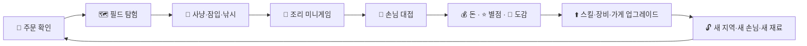
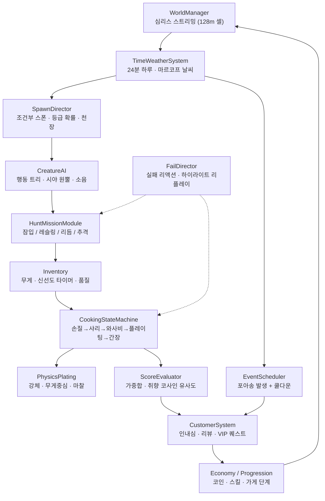

# 🍣 스시 와일드 (SUSHI WILD) — 칼 한 자루 들고 대자연으로

### 코믹 하드코어 오픈월드 초밥 게임 · 상세 기획서 v0.1

> "재료는 사는 게 아니여. **구하는 겨.**" — 와사비 할배

| 항목 | 내용 |
|---|---|
| 문서 버전 | v0.1 (초안) |
| 작성일 | 2026-10-17 |
| 작성 | 티모시 (게임 기획 · 밸런스 통계) |
| 장르 | 오픈월드 액션 어드벤처 + 요리 시뮬레이션 + 슬랩스틱 코미디 |
| 플랫폼 | PC(Steam), 콘솔(PS5 / Xbox Series / 닌텐도 스위치 2) |
| 엔진(안) | Unity 6 (URP 툰 셰이더) 또는 Unreal Engine 5 (World Partition) |
| 시점 | 필드: 3인칭 자유 시점 / 주방: 위에서 내려다보는 클로즈업 |
| 목표 등급 | 12세 이용가 (피·고어 0%, 카툰 슬랩스틱만) |
| 플레이타임 | 메인 스토리 약 25시간 / 도감 100% 60시간 이상 |
| 인원 | 1인 플레이 (2인 로컬 협동 '주방 난장판 모드'는 확장 목표) |

> 🧒 **초딩 설명**
> 요리사가 되어서 마트 대신 바다·숲·농장에 직접 가요. 닭이랑 숨바꼭질하고, 참치랑 씨름해서 재료를 구해 와요.
> 그 재료로 초밥을 만들어 손님한테 주는데, 와사비를 너무 많이 넣으면 손님이 **로켓처럼 날아가요!**

---

## 📑 목차

0. [한눈에 보기](#0-한눈에-보기)
1. [게임 타이틀 제안](#1-게임-타이틀-제안)
2. [오픈월드 구성 & 아트](#2-오픈월드-구성--아트)
3. [중독적인 맵 탐험과 기믹 (Core Loop)](#3-중독적인-맵-탐험과-기믹-core-loop)
4. [1단계: 재료 채집/사냥 페이즈](#4-1단계-재료-채집사냥-페이즈)
5. [2단계: 초밥 조리 페이즈](#5-2단계-초밥-조리-페이즈)
6. [VIP 손님 퀘스트 & 돌발 이벤트](#6-vip-손님-퀘스트--돌발-이벤트)
7. [실패(Game Over) 조건 & 코믹 페널티](#7-실패game-over-조건--코믹-페널티)
8. [개발 구조 (실제로 만들 수 있게)](#8-개발-구조-실제로-만들-수-있게)
9. [부록: 웃음 재료 창고](#9-부록-웃음-재료-창고)

---

## 0. 한눈에 보기

### 0-1. 엘리베이터 피치 (30초 설명)

평화로운 **샤리 섬**. 어느 날 대형 체인 **'스시마트'** 의 회장 **마구로 다이묘**가 섬의 모든 시장과 상점을 몽땅 사들이고 이렇게 선언한다.

> "이제부터 재료 판매 금지! 모두 우리 공장 초밥만 먹어라!"

주인공 **샤리**는 은퇴한 전설의 초밥왕 **와사비 할배**에게서 다 쓰러져 가는 **골판지 포장마차**를 물려받는다. 시장이 없으니 방법은 하나다.

**직접 구한다.** 바다에서, 숲에서, 그리고… 남의 닭장에서.

- **최종 목표**: 게임 속 1년 뒤 **간장 화산** 꼭대기에서 열리는 **'천하제일 초밥왕 대회'**에서 마구로 다이묘를 꺾고 **궁극의 초밥왕**이 되기.

### 0-2. 디자인 기둥 3개 (흔들리면 안 되는 원칙)

| 기둥 | 한 줄 정의 | 이렇게 지킨다 |
|---|---|---|
| 🤣 **실패도 개그다** | 실패 장면이 성공 장면보다 더 웃겨야 한다 | 모든 실패에 전용 리액션 애니메이션 + 사진 모드 자동 캡처 |
| 🌏 **세상 전부가 재료** | 눈에 보이는 건 다 초밥이 된다 (진짜로) | 기본 재료 120종 + 변종 60종. 이상한 재료일수록 보상이 큼 |
| ⚖️ **영업 vs 모험 줄다리기** | 가게를 비우면 손님이 화나고, 안 나가면 재료가 없다 | '손님 인내심 타이머' × '재료 신선도 타이머'의 이중 압박 |

### 0-3. 주요 등장인물

| 캐릭터 | 설명 | 개그 포인트 |
|---|---|---|
| **샤리** (주인공) | 견습 초밥 요리사. 이름·외형 커스터마이즈 가능 | 자기 몸보다 큰 식칼을 등에 메고 다님. 넘어지면 칼이 먼저 착지함 |
| **와사비 할배** | 은퇴한 전설의 초밥왕, 멘토. 충청도 사투리 | "급할수록 천천히 혀유~ 밥알은 도망 안 가유. …참치는 도망가유." |
| **마구로 다이묘** | 라이벌, 스시마트 회장 | 참치 탈을 쓴 사람인지, 사람 탈을 쓴 참치인지 아무도 모름 |
| **돈 꼬꼬레오네** | 꼬꼬댁 농장을 지배하는 마피아 보스 암탉 | "알을 원한다고? 거절할 수 없는 꼬꼬댁을 하지." |
| **불곰 브루노** | 연어 마니아 곰. 진상 단골 → 나중에 경호원 | 자기 연어를 아기처럼 안고 자장가를 불러 줌 |
| **개굴레오** | 기상캐스터 개구리 | 화면 구석에 자기 예보 적중률이 늘 떠 있음 (평균 70%) |

---

## 1. 게임 타이틀 제안

| # | 타이틀 | 뜻 / 노림수 | 태그라인 | 로고 콘셉트 |
|---|---|---|---|---|
| ① | **스시 와일드 (SUSHI WILD)**<br>— 칼 한 자루 들고 대자연으로 | '야생(Wild)'에서 재료를 구하는 오픈월드라는 게 한 번에 읽힘 | "마트는 없다. 대자연이 너의 냉장고다." | 초밥 한 점 위에 산·바다·숲이 통째로 올라간 디오라마 |
| ② | **그랜드 테프트 스시 (Grand Theft Sushi)** | 훔치고, 튀고, 쫓기는 '생존형 재료 수급'을 대놓고 패러디 | "알 하나 훔쳤을 뿐인데, 농장 전체가 날 쫓는다." | 달걀을 품에 안고 닭 떼에게 쫓기는 요리사 실루엣 |
| ③ | **브레스 오브 더 와사비 (Breath of the Wasabi)** | 탁 트인 대자연 탐험 + 코가 찡~한 와사비 '숨결'의 이중 말장난 | "한 입 먹으면, 숨결이 불꽃이 된다." | 언덕 위에서 입으로 불을 뿜으며 날아가는 손님 |

**✅ 추천안**: ①을 **정식 타이틀**로 쓴다. 누가 봐도 바로 이해되고, 상표·검색에서 안전하다.
②·③은 **트레일러 카피 / 사내 코드네임 / 업적 이름**으로 쓴다.

> ⚠️ ②·③은 유명 게임 제목 패러디라서 정식 출시명으로 쓰면 상표 분쟁 위험이 있다. 법무 검토가 필요하다.

---

## 2. 오픈월드 구성 & 아트

### 2-1. 월드 맵 (심리스, 약 4km × 4km)

로딩 화면 없이 모든 지역이 자연스럽게 이어진다.

```
                    ❄️ 가리 설산
                         │
   🌲 고추냉이 숲 ──── 🌾 샤리 평야 ──── 🌋 간장 화산
         │                 │                  │
   🐔 꼬꼬댁 농장 ──── 🏮 샤리 마을 ──── 🐄 음메 목장
                       (내 가게)
                           │
                  🌊 고등어 해변 & 낚시터
                           │
                    🌑 심해 해구 (엔드게임)
```

| 지역 | 분위기 | 주요 재료 | 대표 기믹 | 해금 |
|---|---|---|---|---|
| 🏮 샤리 마을 | 허브. 내 가게, 대장간, 할배 집 | — | 손님 대기줄, 가게 업그레이드 | 시작 |
| 🌊 고등어 해변 | 노을 맛집. 갈매기 날강도 출몰 | 고등어, 참치, 새우, 김 | 리듬 낚시, 참치 레슬링 | 시작 |
| 🐔 꼬꼬댁 농장 | 평화로운 척하는 마피아 소굴 | 계란, 닭 | 잠입 액션 | 1장 |
| 🌲 고추냉이 숲 | 반딧불, 안개, 비명 지르는 와사비 | 와사비, 멧돼지, 버섯, 연어(계곡) | 추격전, 곰 영역 | 1장 |
| 🌾 샤리 평야 | 황금 들판, 허수아비 경비대 | 쌀, 오이 | 메뚜기 디펜스 | 2장 |
| 🐄 음메 목장 | 서부 영화 분위기 | 소고기 | 정오의 젓가락 결투 | 2장 |
| ❄️ 가리 설산 | 생강 향 나는 눈보라 | 생강, 털게 | 체온 게이지, 스노보드 | 3장 |
| 🌋 간장 화산 | 간장 용암이 흐름 (짭짤함) | 화산 장어, 불사조 닭 | 최종 대회장 | 4장 |
| 🌑 심해 해구 | 빛나는 심해 생물들 | 전설의 심해 오징어 | 산소 게이지, 어둠 | 엔드게임 |

### 2-2. 이동 수단

- **걷기 / 달리기 / 구르기**: 구르면 식칼이 먼저 데굴데굴 굴러감.
- **🍣 회전초밥 레일 (빠른 이동)**: 섬 곳곳의 '레일 정류장'을 찾으면 열린다. 거대한 초밥 접시에 앉아 레일을 타고 이동한다.
  - 이동하는 동안 **재료 신선도가 계속 깎인다** → 공짜 순간이동이 아니다 (밸런스 장치).
  - 업그레이드하면 '냉장 접시'가 되어 신선도가 덜 깎인다.
- **🛵 탈것**: 길들인 동물을 탄다. 멧돼지는 돌진형, 폭주족 참치 스쿠터는 해안도로 고속형, 타조는 점프형.
  - 탈것도 재료로 쓸 수 있을까? → **가능하다.** 단, 친구를 먹으면 할배가 3일 동안 말을 안 한다.

### 2-3. 아트 디렉션

- **원칙: "배경은 다큐멘터리, 캐릭터는 개그 만화"**
  - **배경**: 수채화 톤의 셀셰이딩. 노을·안개·물결에 공을 들인다. 스크린샷만 봐도 힐링되는 수준.
  - **캐릭터·동물**: 2.5등신, 굵은 눈썹, 과장된 늘어남·찌그러짐. 모든 동물에게 **직업과 성격**이 있다.
- **🚫 고어 0% 규칙** (남녀노소 모두 편하게 즐기기 위한 핵심)
  - 포획하면 동물이 만화식으로 기절(머리 위에 별 3개) → **펑!** 연기 → 깔끔하게 랩 포장된 **'재료 팩'**이 떨어짐 → 동물은 분해서 발을 구르며 도망감.
  - 세계관 설정: 이 섬의 동물은 재료가 **다시 자란다(리스폰)**. "내일 또 와라, 이 요리사 놈아!"
  - 칼질은 재료 팩 상태에서만 한다. 피 대신 반짝이와 밥알 이펙트.
- **UI**: 나무 도마·족자 스타일. 붓으로 쓴 손글씨 폰트.

---

## 3. 중독적인 맵 탐험과 기믹 (Core Loop)

> 🧒 **초딩 설명**
> "재료 구하기 → 초밥 만들기 → 돈 벌기 → 더 멋진 칼·가게 사기 → 더 먼 곳 가기"를 빙글빙글 반복해요.
> 그런데 할 때마다 새롭고 이상한 동물이 튀어나와서 멈출 수가 없어요!

### 3-1. 세 겹의 루프



| 루프 | 길이 | 내용 | 보상 느낌 |
|---|---|---|---|
| **마이크로** | 30초 | 발견 → 추격/잠입 → 포획 → 리액션 | "잡았다!" 손맛 + 웃긴 리액션 |
| **미드** | 하루 = 현실 24분 | 새벽 사냥 → 영업 → 밤 전설 탐색 | 하루 정산 화면 (매출, 별점, **오늘의 대참사 하이라이트**) |
| **매크로** | 수십 시간 | 가게 6단계 성장, 지역 해금, 도감 완성, 대회 우승 | 포장마차가 성채가 되는 '비포/애프터' |

**하루 시간표** (게임 속 1시간 = 현실 1분)

| 게임 시각 | 현실 시간 | 할 일 |
|---|---|---|
| 05~10시 | 5분 | 새벽 사냥 (동물들이 졸려서 은신이 쉬움) |
| 10~14시 | 4분 | 점심 영업 |
| 14~18시 | 4분 | 낮 탐험 / 재료 보충 |
| 18~22시 | 4분 | 저녁 영업 (VIP 등장률 ↑) |
| 22~05시 | 7분 | 밤 탐험 (전설 재료 출몰, 위험 ↑) |

### 3-2. 중독 장치 ① 스시피디아 (변종 재료 도감)

- 기본 재료 120종 + 변종 60종 = **180칸**.
- 한 칸은 4단계로 채워진다: **실루엣 → 목격 → 포획 → 초밥 완성**. 4단계를 다 채우면 칸에 금테가 둘러진다.

| 변종 이름 | 원재료 | 등급 | 출몰 조건 | 특징 / 공략 | 이 초밥을 먹은 손님 |
|---|---|---|---|---|---|
| 황금똥 비단닭 **'골디'** | 닭 | 전설 | 맑은 날 정오, 농장 지붕 위 | 황금 똥을 싸며 도망. 똥을 밟으면 미끄러지지만 주워서 팔면 돈이 됨 | 금니를 드러내며 웃고 팁 5배 |
| 폭주족 참치 **'스피드왕'** | 참치 | 영웅 | 금요일 밤, 해안도로 | 오토바이 타고 경적 울리며 질주. 바나나 껍질로 넘어뜨리기 | "부릉부릉" 소리 내며 퇴장. 가게 앞에 스키드마크 |
| 근육 연어 **'슈왈츠'** | 연어 | 영웅 | 아침, 폭포 | 폭포를 거꾸로 오르며 팔굽혀펴기. 레슬링으로만 잡힘 | 근육이 3초간 부풀어 옷이 찢어짐 (속옷은 안전) |
| 철학자 소 **'소크라테소'** | 소 | 희귀 | 해 질 녘, 목장 언덕 | 질문에 답해야 다가옴. "너 자신을 알라… 그리고 나를 먹지 마라" | 갑자기 인생을 깨닫고 팁을 두고 감 |
| **방탄새우단** | 새우 | 희귀 | 주말 저녁, 해변 공연장 | 7마리 아이돌 그룹. 갈매기 팬클럽 사이에 섞여 잠입 | 칼군무를 추며 퇴장 |
| 먹물 시인 문어 **'옥토포에'** | 문어 | 희귀 | 비 오는 날, 갯바위 | 먹물로 바위에 시를 씀. 시를 칭찬하면 방심함 | 즉석에서 시를 읊음 (랜덤 생성) |
| 눈 맞춘 광어 **'대칭이'** | 광어 | 희귀 | 바닷가 거울 바위 | 자기 얼굴에 푹 빠져 있음. 거울로 유인 | 거울 셀카를 찍음 |
| 다이어트 돼지 **'저칼로리 박'** | 멧돼지 | 일반 | 아침, 숲 산책로 | 조깅 중. 같이 뛰어서 지치게 해야 함 | 체중계 숫자가 0.5kg 줄어듦 (기분 탓) |
| 닌자 장어 **'스르륵'** | 장어 | 영웅 | 안개 낀 밤, 강 | 연막탄 + 분신술 3마리. 진짜는 그림자가 있음 | 연기와 함께 사라짐 (돈은 두고 감) |
| 투명 해파리 **'없어'** | 해파리 | 전설 | 달 없는 밤, 얕은 바다 | 진짜로 안 보임. 밟으면 찌릿! → 위치를 알 수 있음 | 3초간 투명해져서 옷만 걸어 나감 |
| 유튜버 오징어 **'구독오징'** | 오징어 | 희귀 | 낮, 해변 | 셀카봉 들고 생방송 중. 방송 중에 잡으면 시청자 반응 폭발 | 가게 홍보 효과 (다음 날 손님 +20%) |
| 전설의 심해 오징어 **'크라켄 다이스케'** | 오징어 | 전설 | 비 오는 밤 23~03시, 해변 끝 등대 | 거대함. 다리 10개와 동시에 줄다리기 | 먹물을 뿜어 가게 벽에 수묵화 완성 (인테리어 보너스) |
| **'초밥이 되고 싶은 초밥'** | ??? | 밈급 | 비밀 (조건 퍼즐) | 스스로 밥 위에 올라감. 근데 너무 빨리 도망감 | ??? |

**등급과 확률** (조건이 맞아 무언가 나타났을 때, 어떤 등급이 나오는지)

| 등급 | 테두리 | 등장 확률 | 평균 필요 시도 | 천장 (보장) |
|---|---|---|---|---|
| 일반 | 흰색 | 60% | 약 1.7번 | — |
| 희귀 | 파랑 | 28% | 약 3.6번 | — |
| 영웅 | 보라 | 9% | 약 11번 | 30번째 확정 |
| 전설 | 금색 | 2.5% | 40번 | 100번째 확정 |
| 밈급 | 무지개 | 0.5% | — | 확률이 아니라 **조건 퍼즐**로 확정 소환 |

> 📊 **밸런스 메모 — "평균 40번"의 함정**
> - 전설(2.5%)은 평균 40번 만에 나오지만, **40번 해도 실제로 손에 넣을 확률은 약 64%뿐**이다. 나머지 36%는 "난 왜 안 나와!" 상태가 된다.
> - 99번 연속으로 못 만날 확률은 약 **8%**. 그래서 **100번째 확정(천장)**은 '운이 나쁜 8%를 구하는 안전망'이다.
> - 영웅(9%)도 29번 연속 실패할 확률이 약 6.5%라서 30번째에 천장을 둔다.
> - 밈급(0.5%)은 평균 200번이라 너무 지루하다. 그래서 0.5% 확률로는 '단서'만 나오고, 단서를 모아 **퍼즐로 확정 소환**한다.
>
> 🧒 **초딩 설명**: 주사위에서 6이 나오려면 평균 6번 던져야 해요. 그런데 10번 던져도 6이 안 나오는 친구가 6명 중 1명쯤 있어요(약 16%). 그 친구가 울지 않게 "100번째엔 무조건 나와!" 하고 약속을 걸어 둔 거예요.

**도감 보상**

- 10% 채울 때마다 → 할배의 **비법 두루마리** (스킬 포인트)
- **세트 보너스**: 예) '바다 폭주족 세트' 3종을 모으면 → 탈것 '참치 스쿠터' 해금
- 100% 달성 → 히든 엔딩 + 금빛 식칼

### 3-3. 중독 장치 ② 성장과 확장

**스킬 트리 4갈래** — 어떤 요리사가 될지 내가 고른다.

| 트리 | 콘셉트 | 대표 스킬 (Lv1 → MAX) |
|---|---|---|
| 🥷 **은신** | 닌자 요리사 | 발소리 감소 → 덤불 위장 → 골판지 상자 → 닭 코스튬(볏 각도 자동 보정) → 투명 앞치마 |
| 🏃 **기동** | 육상 요리사 | 달리기 +10% → 슬라이딩 → 벽 타기 → 2단 점프 → 식칼 장대높이뛰기 |
| 💪 **완력** | 레슬러 요리사 | 잡기 → 업어치기 → 드롭킥 → 수플렉스 → 참치 자이언트 스윙 |
| 🍣 **손맛** | 장인 요리사 | 판정 범위 +5% → 와사비 미세조정 → 슬로모션 플레이팅 → 밥알 텔레파시(밥알 수 자동 표시) → **신의 손** (하루 1회 Perfect 확정) |

**가게 6단계 성장** (화폐: 밥알 코인 🍚)

| 단계 | 이름 | 필요 코인 | 좌석 | 새로 열리는 것 | 외관 개그 |
|---|---|---|---|---|---|
| 1 | 골판지 포장마차 | 시작 | 2 | — | 비 오면 지붕이 녹아서 손님이 우산 쓰고 먹음 |
| 2 | 리어카 포차 | 5만 | 4 | 출장 영업 (리어카 끌고 해변으로) | 내리막에서 가게가 혼자 굴러감 |
| 3 | 동네 초밥집 | 30만 | 8 | 직원 1명, 냉장고 | 네온 간판 '초밥왕'의 'ㅗ'가 계속 깜빡임 |
| 4 | 회전초밥 레스토랑 | 150만 | 20 | 회전 레일, 직원 3명 | 레일이 너무 빨라서 초밥이 손님을 지나쳐 날아감 (업그레이드로 해결) |
| 5 | 초밥 대저택 | 600만 | 40 | VIP룸, 대형 수족관 | 수족관 물고기들이 메뉴판을 보고 기절함 |
| 6 | 초밥 성채 **'샤리성'** | 2,000만 + 대회 우승 | 100 | 간장 해자, 천수각 꼭대기의 거대 연어초밥 조형물 | 성벽 대포가 초밥을 손님 입으로 발사 (명중률 업그레이드 필요) |

**장비**

- **식칼 계보**: 나무 식칼 → 대장간 식칼 → 참치뼈 식칼 → 전설의 **'엑스칼리밥'**
- **아이스박스**: 신선도 반감기 ×1.5 → ×2 → ×3 (아래 4-1 참고)
- 낚싯대, 그물, 위장복(골판지 상자 / 닭 코스튬 / 덤불 / 허수아비)

**직원** — 잡는 대신 '설득'한 동물이 직원이 된다.

- 불곰 브루노: 경호원 (진상 손님 자동 퇴치)
- 너구리: 서빙 담당. 단, 8% 확률로 초밥을 몰래 먹음
- 문어: 다리 8개로 설거지 8배속

### 3-4. 중독 장치 ③ 날씨 · 시간 기믹

| 환경 조건 | 무슨 일이 생기나 | 재미 포인트 |
|---|---|---|
| 🌧️ **비 오는 밤 (23~03시)** | 전설의 심해 오징어 '크라켄 다이스케'가 등대 아래 등장 | 다리 10개와 동시에 줄다리기하는 보스전 |
| 🌕 보름달 | 음메 목장의 소들이 울부짖는 **'늑대소'**로 변신 | 평소 순한 소가 나를 쫓아옴 → 도망치며 사냥 |
| ⛈️ 천둥번개 | 전기뱀장어들이 해변 피뢰침에 **'충전'**하러 모임 | 고무장갑 필수. 감전되면 머리가 아프로가 됨 |
| 🌫️ 안개 | 닌자 장어, 유령 고등어 출몰 | 시야 50% ↓, 대신 은신 50% ↑ |
| 🌈 비 그친 직후 무지개 | 무지개 송어가 무지개 위를 헤엄쳐 하늘로 올라감 | 무지개 다리 파쿠르 (무지개가 사라지면 추락!) |
| ☀️ 폭염 | 해변에서 일광욕하는 '선탠 새우' 출몰 | 선크림 안 바르면 요리사도 빨갛게 익음 |
| ❄️ 눈 | 설산 털게가 스노보드 타고 활강 | 스노보드 레이스 |
| 🌑 일식 (게임 속 1년에 1번) | 모든 동물이 반대로 행동 (닭이 요리사를 무서워함) | 하루 한정 '역전의 날' |
| 📅 현실 월요일 아침 | 소들이 출근하기 싫어서 늦잠 → 사냥 쉬움 | 현실 요일과 연동된 소소한 개그 |
| 🎄 현실 크리스마스 | 산타 연어가 썰매를 끌고 하늘을 남 | 시즌 한정 도감 |

**날씨는 어떻게 정하나? — "어제 날씨를 보고 다음 날씨를 정한다"**

날씨는 게임 속 4시간마다 바뀐다. 다음 날씨는 '지금 날씨'에 따라 확률이 달라진다 (마르코프 연쇄). 비가 오면 한동안 비가 이어지기 쉬운, 진짜 날씨 같은 느낌을 준다.

| 지금 ↓ / 다음 → | 맑음 | 흐림 | 비 | 안개 |
|---|---|---|---|---|
| 맑음 | 60% | 25% | 10% | 5% |
| 흐림 | 30% | 35% | 25% | 10% |
| 비 | 15% | 35% | 40% | 10% |
| 안개 | 40% | 30% | 10% | 20% |

→ 오래 플레이하면 날씨 비율은 **맑음 40% · 흐림 31% · 비 21% · 안개 9%** 정도로 자리 잡는다.

> 📊 **밸런스 메모 — 전설 오징어는 얼마나 자주 볼 수 있을까?**
> - 23~03시(날씨 칸 2개) 중 한 번이라도 비가 올 확률 ≈ **33%**
> - 비 오는 밤에 오징어가 나타날 확률을 35%로 두면 → 하루 기준 약 **11.7%**
> - 평균 **약 8.6일** (현실 약 3시간 26분) 만에 한 번 만난다. 7일 안에 만날 확률은 58%, 14일 안에는 82%.
> - 너무 감질나서 그만두는 사람이 없도록 **안전장치**: 7일 동안 못 만나면 개굴레오가 **'기우제' 퀘스트**를 준다. 리듬 댄스에 성공하면 다음 날 밤 비 100%!

**일기예보 = 내일 접속할 이유**

매일 아침 개굴레오가 내일 날씨를 알려 준다.

> "내일 밤 비 올 확률 62%… 근데 제 적중률은 70%예요. 개굴."

예보는 '떡밥'이다. 이걸 보면 "내일 밤엔 꼭 들어와야지" 하게 된다.

### 3-5. "한 판만 더" 장치 (끄지 못하게 만드는 것들)

1. **마감 직전 VIP 노크** — 영업 마감 2분 전에 확률적으로 VIP가 등장. "이 손님만 받고 끄자…"
2. **내일 예보 떡밥** — 하루 정산 화면 맨 마지막 줄: *"내일 밤: 비 62% / 전설 출몰 가능"*
3. **도감 '1칸 남음' 알림** — 세트 보너스까지 하나 남으면 지도에 '?'가 뜸
4. **150m 법칙** — 어느 방향으로 걸어도 150m 안에 뭔가(보물, 이상한 동물, NPC 개그, 비밀 레시피 두루마리)가 있다. 단, 지도에 마커를 도배하지 않고 '소문'으로만 알려 준다.
5. **오늘의 대참사 하이라이트** — 하루 정산 때 가장 웃긴 실패 장면 3개를 자동 리플레이 + 공유 버튼
6. **신선도 시한폭탄** — 잡은 재료가 상하기 전에 가게로 가야 함 → "한 번만 더 다녀오자"의 무한 연쇄
7. **손님 다이어리** — 단골손님마다 숨은 이야기가 있어서, 5번 대접할 때마다 다음 이야기가 열림

### 3-6. 영업 vs 모험 줄다리기

- 가게를 비운 동안 **손님 인내심 게이지**가 줄어든다. 다 떨어지면 손님들이 **가게 의자와 메뉴판을 뜯어 먹기 시작한다.**
- 해결책: 직원 고용 / 가게 앞에 **'잠깐 사냥 나감' 팻말** 걸기 (인내심 감소 -30%, 단 착한 손님만 믿어 줌)

---

## 4. 1단계: 재료 채집/사냥 페이즈

> 🧒 **초딩 설명**
> 재료마다 잡는 방법이 다 달라요. 닭알은 숨바꼭질, 참치는 씨름, 멧돼지는 술래잡기!
> 그리고 잡은 생선은 아이스크림처럼 '녹아요'(상해요). 그래서 빨리 가게로 가져가야 해요.

### 4-1. 공통 시스템

| 시스템 | 설명 | 화면 표시 |
|---|---|---|
| ❤️ 체력 | 0이 되면 기절 → 7장 페널티 | 하트 대신 '밥공기' 아이콘 |
| ⚡ 스태미나 | 달리기·레슬링·수영에 소모 | 간장 종지 게이지 |
| 👁️ 시야 원뿔 | 경비 동물이 보는 범위. 노랑 = 의심, 빨강 = 들킴 | 바닥에 부채꼴로 표시 |
| 🔊 소음 | 달리기 > 걷기 > 웅크리기. 냄비 밟으면 최대 | 화면 가장자리에 파동 |
| 🎒 가방 무게 | 무거우면 느려짐. 참치 한 마리 = 가방 80% | 무게 막대 |
| ❄️ 신선도 | 시간이 갈수록 줄어듦 (아래 공식) | 재료 아이콘 테두리 색 |
| 😰 재료 스트레스 | 어떻게 잡았는지에 따라 품질 결정 | 잡은 직후 표시 |

**신선도 공식** — 반감기마다 신선도가 절반으로 줄어든다.

```
신선도(t) = 100 × (1/2) ^ (t ÷ 반감기)
```

| 재료 | 반감기 (현실 분) | 5분 뒤 | 10분 뒤 | 메모 |
|---|---|---|---|---|
| 새우 | 6분 | 56% | 31% | 가장 급함 |
| 참치 | 8분 | 65% | 42% | |
| 계란 | 30분 | 89% | 79% | 대신 깨질 위험 |
| 쌀 | 없음 | 100% | 100% | 대신 비 맞으면 불어서 '죽'이 됨 |
| 소고기 | 특수 '숙성 곡선' | — | — | 처음 5분은 오히려 맛 +10% 상승, 그 뒤 반감기 12분 |

- 아이스박스를 업그레이드하면 반감기가 ×1.5 / ×2 / ×3으로 늘어난다.

> 🧒 **초딩 설명**: 새우는 6분마다 신선함이 반으로 줄어요. 100 → 50 → 25… 그러니까 새우 잡으면 뒤도 돌아보지 말고 가게로 뛰어요!

**어떻게 잡았나 = 어떤 맛이 되나** (재료 스트레스 시스템)

| 잡는 방식 | 스트레스 | 품질 | 개그 연출 |
|---|---|---|---|
| 🥷 안 들키고 잠입 | 0 | +20% (S등급 가능) | 동물: "어? 내 거 어디 갔지?" |
| 🎣 기술 (리듬 Perfect) | 낮음 | +10% | 생선이 엄지척하고 기절 |
| 💪 난투 / 레슬링 | 높음 | -10% (근육이 굳어서 질김) | 대신 헬스 손님에겐 +30% |
| 🏃 오래 쫓아가서 잡기 | 중간 | 0% | 둘 다 헉헉 |

→ **플레이 스타일이 곧 가게의 정체성**이 된다. 은신파는 고급 오마카세집, 레슬러파는 '단백질 초밥' 전문점이 된다.

### 4-2. 재료별 사냥 미션

#### 🥚 [잠입] "꼬꼬레오네 패밀리의 알"

- **장소 / 시간**: 꼬꼬댁 농장 / 아무 때나 (새벽엔 경비가 졸음)
- **상황**: 마피아 보스 암탉 **돈 꼬꼬레오네**가 둥지 위에 앉아 시가 대신 지렁이를 물고 있다. 부하 병아리 **'삐약 형제'** 3마리가 순찰을 돈다.
- **기믹**
  - **시선 피하기**: 대부의 시선은 10초마다 좌→우로 훑는다. 가끔(20%) '뒤돌아보는 척' 페이크를 쓴다.
  - **위장**: 골판지 상자 / 닭 코스튬(볏 각도가 틀리면 "저 닭 볏이 왜 저래?" 의심 게이지 상승) / 허수아비 흉내
  - **미끼**: 옥수수를 던지면 병아리들이 우르르 몰려간다. 단, 대부는 안 넘어간다. "날 병아리로 아나?"
  - **알 빼기 미니게임**: 대부 엉덩이 밑에서 알을 살금살금 당긴다. 스틱을 너무 빨리 움직이면 대부가 '흠칫'.
  - **탈출**: 알을 들고 뛰면 **흔들림 게이지**가 오른다. 꽉 차면 깨진다. "계란말이가 아니라 계란 쏟아짐."
- **들키면**: "꼬끼오오오!" 경보 → 농장의 모든 닭이 공습. 30초 버티거나 건초더미에 숨어야 한다.
- **변종 연계**: 대부가 진짜 아끼는 **황금알**을 훔치면 → 마피아 복수 퀘스트 **'알의 대부'**로 이어진다.

#### 🐟 [레슬링] "근육 참치와 바다 위의 링"

- **장소**: 고등어 해변 먼바다, 작은 어선 위
- **상황**: 낚싯줄에 걸린 참치가 물 밖으로 튀어 올라 배 위에 착지한다. 순간 배가 **프로레슬링 링**으로 변신! 로프는 낚싯줄, 링 아나운서는 갈매기. "레이디스 앤 젠틀맨~!"
- **기믹**
  - **그래플 시스템**: 잡기 / 던지기 / 반격의 가위바위보. 참치는 내 패턴을 학습한다.
  - **참치 필살기 '꼬리 싸대기 콤보'**: 꼬리가 부르르 떨리는 예고 동작을 보고 피한다.
  - **관중 갈매기**들이 링 위로 생선 머리를 던짐 → 밟으면 미끄러지는 함정
  - **핀폴**: 참치 스태미나가 바닥나면 3카운트 (버튼 연타). 1, 2… 참치가 **매번 2.9에서** 어깨를 든다.
- **실패**: 참치가 요리사를 바다로 '보디슬램' → 헤엄쳐서 복귀 (그동안 신선도 깎임)
- **품질**: 레슬링으로 잡으면 '근육 경직' -10%. 하지만 원래 근육질 참치라 단백질 손님 선호도는 최상.

#### 🎣 [리듬] "낚싯줄 위의 콘서트"

일반 생선은 리듬 게임으로 낚는다. 생선마다 음악 장르와 빠르기(BPM)가 다르다.

| 생선 | 장르 | BPM | 특징 |
|---|---|---|---|
| 광어 | 발라드 | 70 | 느리지만 길게 누르는 노트가 많음 |
| 고등어 | 트로트 | 130 | '꺾기' 노트 (방향 전환) |
| 연어 | K-POP | 120 | '킬링 파트' 구간 성공하면 즉시 포획 |
| 장어 | EDM | 160 | 드롭 구간에 노트 폭주 |
| 복어 | 레게 | 90 | 엇박자. 실패하면 복어가 부풀어 비치볼이 됨 → **비치발리볼 미니게임**으로 전환 |

- **줄 텐션 게이지**: 노트를 놓치면 텐션이 올라가고, 너무 높으면 줄이 끊긴다.
- **최후의 버티기**: 줄이 끊기기 직전, 요리사가 물로 끌려가며 **수상스키 미니게임**으로 강제 전환된다. 해안의 장애물을 피해 버티면 역전 포획!

#### 🐗 [추격] "식칼 한 자루, 멧돼지 한 마리"

- **장소**: 고추냉이 숲
- **상황**: 초밥용 식칼 하나 들고 멧돼지를 쫓는다. 멧돼지는 나무를 부수며 직진한다.
- **기믹**
  - **파쿠르 추격**: 쓰러진 나무 밑 슬라이딩, 덩굴 스윙, 버섯 트램펄린
  - **멧돼지의 꾀**: 진흙탕에 숨기, 가짜 발자국 남기기, 다른 멧돼지와 '교대'하기 (얼굴 비교 미니게임: 누가 진짜?)
  - **⚠️ 역추격 페이즈**: 멧돼지 분노 게이지가 꽉 차면 멧돼지가 돌아서서 **나를 쫓아온다!** BGM도 뒤집힌다. 이때 멧돼지를 나무에 박게 유도하면 기절 → 포획 찬스.
  - **둘 다 지쳤을 때**: 숲 한가운데 같이 주저앉아 헉헉댄다 → 숨은 선택지 **"같이 쉰다"** → 우정 게이지 → 포획 대신 **탈것 '멧돼지'**를 얻는 루트
- **실패**: 멧돼지 엉덩이 박치기에 요리사가 하늘로 날아가 '반짝'하고 사라짐 → 마을 근처에 착지

#### 🐄 [육성 + 결투] "마블링은 사랑이다 / 정오의 젓가락"

- **장소**: 음메 목장 (서부 영화 분위기)
- **루트 A — 평화**: 소 **'마블리'**에게 리듬 마사지를 해 준다. 행복 게이지가 오를수록 마블링 등급이 오른다. 최고 등급이 되면 소가 직접 등심 팩을 내밀어 준다. "가져가… 내일 또 자라니까."
- **루트 B — 결투**: 목장주인 카우보이 소 **'클린트 이스트우소'**와 정오 12시 정각, 마을 한복판에서 **젓가락 결투**. "드로우!" 신호가 뜨면 0.3초 안에 젓가락을 던져야 한다. 소는 가끔 신호 전에 먼저 뽑는 반칙을 쓴다.
- **보름달 변종 '늑대소'**: 밤에 갑자기 울부짖으며 쫓아온다. 은신 필수.

#### 그 밖의 재료 미션 (요약)

| 재료 | 미션명 | 장르 | 핵심 기믹 | 웃음 포인트 |
|---|---|---|---|---|
| 🦑 오징어 | 먹물 서바이벌 | 액션 | 먹물에 맞으면 화면 일부가 검게 칠해짐 → 손으로 와이퍼처럼 닦기 | 먹물 3번 맞으면 요리사가 수묵화 캐릭터로 변함 |
| 🐙 문어 | 8다리 가위바위보 | 퍼즐 | 다리 8개로 동시에 가위바위보 → 8판 다 이겨야 함 | 지면 다리 8개로 동시에 눈물 닦기 |
| 🦐 새우 | 방탄새우단 팬사인회 잠입 | 잠입 | 응원봉 들고 갈매기 팬클럽에 섞이기, 떼창 타이밍 맞추기 | 사인 대신 새우를 받아 옴 |
| 🌿 와사비 | 비명 지르는 뿌리 | 타이밍 | 뽑는 순간 비명을 지름 → 귀마개 필수. 비명 때문에 근처 곰이 깸 | 귀마개 없으면 머리카락 쭈뼛 + 코에서 김 |
| 🍚 쌀 | 허수아비 경비대 | 디펜스 | 논을 노리는 메뚜기 떼를 허수아비 배치로 막는 미니 타워디펜스 | 허수아비들이 쉬는 시간에 카드놀이를 함 |
| 🟩 김 | 바위 해안 연날리기 | 타이밍 | 파도 사이에 김 채취. 바람 불면 김이 연처럼 날아가 줄로 조종 | 김이 갈매기 얼굴에 붙어 '김 가면 히어로' 탄생 |
| 🥒 오이 | 갓파의 밭 | 잠입 | 물 요괴 갓파의 밭에서 오이 훔치기. 머리 접시의 물을 쏟게 하면 기절 | 갓파가 인사하다가 스스로 물을 쏟음 |
| 🦀 털게 | 설산 스노보드 | 레이싱 | 스노보드 타는 털게와 활강 레이스 | 게라서 옆으로만 탐 (코스를 가로로 내려옴) |
| 🔥 불사조 닭 | 간장 화산 보스 | 보스전 | 쓰러뜨려도 부활 → 세 번째 부활 때 알을 남김 | 부활할 때마다 "아 진짜?" 표정 |

---

## 5. 2단계: 초밥 조리 페이즈

> 🧒 **초딩 설명**
> 가게에 돌아오면 미니게임 5개로 초밥을 만들어요.
> 밥을 너무 세게 쥐면 돌멩이가 되고, 와사비를 너무 많이 넣으면 손님이 날아가요.
> 재료를 높이 쌓으면 점수가 높지만, 무너지면 0점!

### 5-1. 주방 흐름 (한 접시 = 60~90초)

```
🔪 손질(15초) → 🍚 샤리 쥐기(15초) → 🟢 와사비(10초) → 🧱 플레이팅(20초) → 🥢 간장·마무리(10초) → 🚶 서빙 운반(10~20초)
```

- 숙련도가 오르면 일부 단계는 **자동 처리** 가능 (손맛 스킬) → 같은 미니게임 100번 반복하는 지루함 방지
- 바쁜 시간엔 주문 여러 개를 동시에 처리하는 혼돈의 주방

### 5-2. 🔪 손질: "통통 튀는 도마"

- 화면을 쓱 긋는 칼질. **각도와 두께** 게이지를 맞춘다.
- **신선할수록 탱글탱글 튄다**: 신선도 90% 이상인 재료는 도마 위에서 통통 튀어 다닌다. 썰기는 어렵지만 점수 ×1.3 (위험 vs 보상).
- 결을 따라 썰면 'Perfect 결'. 반대로 썰면 회가 너덜너덜한 **'추상화'**가 된다. 손님: "이건… 피카소?" (단, 예술가 손님에겐 오히려 호평)

### 5-3. 🍚 샤리 쥐기: "밥알 리듬 액션"

4박자 리듬에 맞춰 **쥐기 → 돌리기 → 쥐기 → 톡!** 버튼을 누른다. 누르는 힘(압력) 게이지가 판정을 좌우한다.

| 판정 | 결과 | 연출 |
|---|---|---|
| 너무 약함 | 밥알 공중분해 | 밥알이 폭죽처럼 흩어져 손님 머리 위로 쌀 비가 내림 |
| 약함 | 푸석 | 젓가락으로 집는 순간 무너짐 |
| ✨ **Perfect** | 입에서 사르르 | 밥알들이 아카펠라 화음으로 "아~♪" |
| 강함 | 떡 | 손님이 3분 동안 씹음 (턱 근육이 생김) |
| 너무 강함 | **돌덩이 💎** | 손님 이빨이 '팅!' 튕겨 나가 가게 종을 울림. 어떤 손님은 볼링공으로 들고 나감 |

- **밥알 콤보**: Perfect를 연속으로 성공하면 밥알들이 줄 서서 스스로 걸어와 뭉친다 (3초 자동 쥐기).

### 5-4. 🟢 와사비 룰렛

- 게이지 바늘이 좌우로 왔다 갔다 한다. 원하는 양에서 멈춘다. 와사비 등급이 높을수록 바늘이 빠르다.
- **숨겨진 룰렛**: 와사비 통에 가끔 초강력 **'러시안 와사비'**가 섞여 있다. 화면에 아지랑이가 피어오르는 걸로 알아챌 수 있다 (눈썰미 보상).

| 와사비 양 | 손님 반응 |
|---|---|
| 0~10% | 밍밍함. 하품하다가 졸아서 계산을 잊음 |
| **10~35% ✨ 적정** | 눈물 한 방울. "이것이… 인생…" |
| 35~60% | 콧구멍에서 증기기관차 '뿌~' |
| 60~85% | 입에서 불 뿜기 → 가게 커튼에 불 붙음 (소화기 미니게임) |
| 85~100% 🚀 | **손님 로켓 발사!** 천장을 뚫고 하늘로 |

- **🚀 로켓 손님 그 후**: 손님은 물리 궤적을 따라 맵 어딘가에 떨어진다 → 지도에 '추락 손님' 아이콘이 뜬다 → 찾아가서 구출하면 "그 맛을 잊을 수가 없어요" 하며 **단골**이 되고 사과 보너스를 받는다. **실패가 새 콘텐츠로 이어진다.**
- **반전 손님**: 스릴을 좋아하는 익스트림 다람쥐 **'날다람G'**는 로켓 발사를 원한다. 85% 이상 넣어야 별 5개, 멀리 날아갈수록 팁 추가.
- 로켓 손님이 다른 손님과 공중에서 부딪히면 **연쇄 로켓 도미노** (업적: "휴스턴, 문제가 생겼다")

### 5-5. 🧱 물리 엔진 플레이팅 (젠가식 균형 잡기)

밥 위에 재료를 올리는 물리 퍼즐. 화면에 **무게중심 선**이 보이고, 접시가 살짝 흔들린다.

| 재료 | 무게 | 미끄러움 | 특수 성질 |
|---|---|---|---|
| 참치 뱃살 | 보통 | 보통 | 시간이 지나면 체온에 녹아서 점점 미끄러워짐 |
| 장어 (소스) | 보통 | 매우 미끄러움 | 김 띠로 묶어야 함 |
| 문어 다리 | 가벼움 | 흡착 | 절대 안 떨어짐… 대신 손님 얼굴에 달라붙음 |
| 연어알 | 아주 가벼움 | 구슬처럼 구름 | 탱탱볼처럼 튐. 하나만 떨어져도 가게 전체에 연쇄 튕김 |
| 와규 덩어리 | 아주 무거움 | 잘 안 미끄러짐 | 밥을 짓눌러서 밥이 납작해짐 |
| 황금알 | 보통 | 미끄러움 | 구르는 방향이 랜덤 |
| 신선도 90% 이상 생선 | — | — | 통통 튐 (어렵지만 점수 ×1.3) |

- **타워 초밥 보너스**: 재료를 여러 층 쌓으면 층수마다 ×1.2배. 무너지면 0점. (위험할수록 큰 보상)
- **서빙 운반**: 쟁반 들고 테이블까지 걸어가는 밸런스 게임. 가게가 낡았으면 바닥이 울퉁불퉁하고, 손님 아이들이 뛰어다니며 방해한다.
- 지진 이벤트가 오면 플레이팅 난이도 ×2.

### 5-6. 🥢 간장 & 마무리

- **간장 붓기**: 액체 물리. 붓는 시간 = 양. 너무 많이 부으면 **'간장 홍수'** → 가게 바닥이 간장 바다가 되어 손님들이 튜브 타고 둥둥 떠다님 (그날 영업 끝까지 지속, 청소 미니게임)
- **데코**: 생강, 시소잎, 금박 등을 자유롭게 배치 (사진 모드와 연동)
- **초밥 이름 짓기**: 이름에 '전설', '궁극' 같은 단어를 넣으면 손님 기대치가 올라가서 평가가 엄격해짐 (허세 페널티). 손님 이름을 넣으면 감동 보너스.

### 5-7. 숨겨진 퓨전 레시피 (실험 중독)

재료를 섞어 보면 비밀 레시피가 발견된다 (총 50종).

| 조합 | 레시피 | 손님 효과 |
|---|---|---|
| 황금알 + 폭주족 참치 | 골드러시 롤 | 금빛 오토바이 타고 퇴장, 팁 폭발 |
| 근육 연어 + 와규 | 단백질 폭탄 니기리 | 즉석 보디빌딩 포즈 |
| 투명 해파리 + 아무거나 | 보이지 않는 초밥 | 빈 접시를 먹는 마임 |
| 와사비 3배 + 불사조 닭 | 피닉스 버스트 | 불사조처럼 날아올라 맵 반대편에 착지 (로켓의 상위 버전) |
| 유튜버 오징어 + 방탄새우단 | 바이럴 플래터 | 다음 날 손님 +50% |

### 5-8. 채점 공식 & 손님 취향 레이더

**접시 점수 (0~100점)**

```
점수 = ( 재료 품질 × 0.35
       + 샤리     × 0.20
       + 와사비   × 0.15
       + 플레이팅 × 0.20
       + 취향 일치 × 0.10 ) × 신선도 보정

신선도 보정 = 0.5 + 0.5 × (신선도 ÷ 100)   → 신선도 0%면 점수 반토막
```

- **취향 일치**: 손님마다 5개 축의 레이더 차트가 있다 — **[매운맛, 단맛, 모험심, 비주얼, 양]**. 초밥에도 같은 5축 값이 있어서, 두 모양이 얼마나 닮았는지(코사인 유사도)로 계산한다.
- **별점**: 90점 이상 ⭐5 / 75점 이상 ⭐4 / 60점 이상 ⭐3 / 40점 이상 ⭐2 / 그 아래 ⭐1

> 🧒 **초딩 설명**: 손님마다 좋아하는 맛을 그린 '별 모양 그림'이 있어요. 내 초밥 그림이 손님 그림이랑 똑같이 생길수록 점수가 올라가요.

---

## 6. VIP 손님 퀘스트 & 돌발 이벤트

### 6-1. VIP 퀘스트

#### VIP ① "연어 내놔라 곰" — 불곰 브루노

- **상황**: 브루노가 가게 문을 부수고 들어와 "연어 초밥 내놔!!" 하고 난동을 부린다. 그런데 가게엔 연어가 없다. 브루노 품엔 자기가 잡은 커다란 연어 **'연순이'**가 있다. 절대 안 놓는다.
- **단계**
  1. **난동 진압**: 날아오는 의자·접시를 피하며 꿀단지 던지기 QTE로 진정시키기
  2. **낮잠 유도**: 할배 조언 "곰은 배부르면 자유~" → 숲에서 꿀을 구해 와 먹이기
  3. **연어 훔치기 (잠입)**: 브루노가 연어를 아기처럼 품고 자장가를 흥얼거리다 잠든다. **코골이 리듬**에 맞춰 연어를 살금살금 빼낸다. 코골이가 멈추면 얼음! (무궁화 꽃이 피었습니다)
  4. **조리**: 바로 그 연어로 초밥
  5. **대접**: 브루노 "…이 연어… 왜 이렇게 익숙한 맛이지?" (자기 연어임)
- **결말** (초밥 점수로 결정)
  - 80점 이상: "내 연어로 이런 맛을…!" 감동의 눈물 → **경호원 직원으로 합류**
  - 80점 미만: 화가 나서 가게 지붕을 들고 가 버림 (다음 날 돌려줌. 연어 모양으로 찌그러진 채로)
- **보상**: 직원 '브루노' (진상 손님 자동 퇴치), 업적 **"남의 연어로 생색내기"**

#### VIP ② "꼬꼬레오네 대부의 딸 결혼식"

- **상황**: "자네가 내 알을 훔친 걸 알고 있네. 하지만 오늘은 기쁜 날이니… **거절할 수 없는 주문**을 하지." 딸 **'꼬순이'**의 결혼식 음식 50인분. 단, **계란 초밥은 절대 금지** (하객이 전부 닭이니까).
- **단계**: 50인분 재료를 게임 속 이틀 안에 구하기 → 하객(닭)마다 취향이 다름 ("지렁이 롤 주세요") → 결혼식 당일 연회장 서빙 러시
- **반전**: 하객 중에 스시마트 스파이가 숨어 와사비를 **치약**으로 바꿔치기한다 → 추리 미니게임으로 범인 찾기 (민트 냄새 나는 닭이 범인)
- **보상**: 대부의 '보호' → 농장 잠입 시 경비 의심도 -50%. 단, 황금알은 여전히 금지.

#### VIP ③ "폭주족 참치단의 생일 파티"

- **상황**: 오토바이 탄 참치들 **'바다의 질주단'**이 가게를 포위한다. "우리 막내 '참돌이'를 초밥으로 만들었지?!" (사실 주인공이 잡은 건 다른 참치다)
- **단계**
  1. 해명하려면 **레이스**에서 이겨야 한다. 무대는 회전초밥 레일 위! 레일이 섬 전체를 잇고 있어서 레이스 코스 = 섬 일주.
  2. 이기면 진짜 참돌이 찾기 → 알고 보니 가출해서 **방탄새우단 매니저**로 일하는 중
  3. 참돌이를 데려오면 두목의 생일 파티 주문: "참치 말고, 우리 원수 **'상어 갱'**으로 만들어 줘"
- **보상**: 탈것 '참치 스쿠터', 해안도로 자유 통행, 질주단 단골 등록

#### VIP ④ "미끌랭 가이드 비밀 평가원을 찾아라"

- **상황**: 소문이 돈다. "이번 주 안에 미끌랭 평가원이 손님으로 변장해서 온다."
- **기믹**: 손님 중 누가 평가원인지 추리한다. 단서: 젓가락을 항상 45° 각도로 듦, 몰래 메모함, 가짜 콧수염이 가끔 삐뚤어짐, 물만 3잔 마심.
  - 엉뚱한 손님에게 VIP 대접을 하면 → 그 손님은 감동하지만 진짜 평가원은 소외됨 → 평가 하락
  - 맞히면 특별 오마카세 코스 (5접시 연속, 평균 85점 이상)
- **보상**: 가게 등급 **'미끌랭 별'** (간판에 반짝이 별 + 손님 상한 +30%)
- **개그**: 평가원이 매번 다르다. 너구리일 때도, 거북이일 때도, 심지어 할배일 때도 있다. "내가 평가원이었슈~"

#### VIP ⑤ "외계인 쿠라 X-7의 지구 시식 보고서"

- **상황**: UFO가 가게 앞에 착륙한다. "지구의 대표 음식을 내놓아라. 맛없으면 지구를 **포장해 간다.**"
- **단계**: 외계인 취향 분석 (취향 레이더가 '???'로 표시됨 → 시식 반응을 보고 스무고개로 알아내기) → 필요한 재료 '운석 연어'는 **유성우 내리는 밤**에만 하늘에서 떨어짐 → UFO 안 **무중력 플레이팅** (재료가 둥둥 떠다님)
- **실패**: UFO가 가게를 통째로 견인해 감 → 다음 날 아침 가게가 거꾸로 꽂힌 채 돌아옴 (외계 낙서 포함)
- **성공**: 외계인이 은하계 리뷰 사이트에 별 5개 → 외계인 단골 해금 (가끔 UFO 타고 포장 주문)

#### VIP ⑥ "순자 할머니의 60년 전 그 초밥" (웃음 + 감동)

- **상황**: 허리 굽은 할머니. "젊을 때 첫사랑이 만들어 준 초밥을 한 번만 다시 먹고 싶어…"
- **단계**: 오픈월드 곳곳에서 **기억 조각** 찾기 (해변의 오래된 조개 목걸이, 숲속 나무에 새겨진 이니셜 'ㅇ.ㅅ.ㅂ') → 멸종한 줄 알았던 **'은빛 전어'** 찾아 레시피 복원
- **반전**: 그 첫사랑은 바로 와사비 할배였다. "…순자 씨여? 아이고, 이게 뭔 일이여…" 할배가 60년 만에 직접 칼을 잡고, 플레이어는 보조를 맡는다.
- **보상**: 할배 비전 기술 **'추억의 손맛'** (단골손님 점수 +15%), 웃다가 우는 컷신

### 6-2. 돌발 이벤트

| 이벤트 | 언제 | 무슨 일 | 대처 |
|---|---|---|---|
| 🐦 갈매기 날강도단 | 해변 근처에서 재료 운반 중 | 갈매기 떼가 가방 속 생선을 노리고 급강하 | 우산 방어 / 감자칩 미끼 |
| 🧊 냉장고 대탈주 | 재료 10개 이상 보관한 밤 | 재료들이 냉장고를 탈출 | 손전등 들고 가게 안 숨바꼭질 |
| 🦝 위생 검사관 너구리 | 영업 중 무작위 | 바닥의 밥알·간장 자국 개수 검사 | 10초 청소 미니게임 |
| 🕵️ 스시마트 사보타주 | 매출 순위가 오를수록 자주 | 와사비 → 치약, 간장 → 콜라 바꿔치기 | '맛보기' 버튼으로 확인 (안 하면 손님이 거품 뿜음) |
| 🦆 관광 오리 단체 버스 | 주말 | 오리 40마리가 한꺼번에 들어와 전원 "같은 거" 주문 → 전원 다른 걸로 변경 | 대량 조리 러시 |
| 💡 정전 | 폭풍우 치는 날 | 촛불 영업. 손님 얼굴이 안 보여서 '유령 손님'이 섞여 들어옴 (돈 대신 행운 부적을 줌) | 손전등으로 확인 |
| 🌏 지진 | 화산 지역 해금 후 | 플레이팅 난이도 ×2, 접시가 미끄러짐 | '접시 고정' 스킬 |
| 📱 먹방 유튜버 생방송 | 가게 명성이 일정 이상 | 실시간 채팅이 화면에 흐름. 대실패하면 '밈'이 되어 섬 전체에 퍼짐 → 오히려 구경 손님 증가 (**악명도** 시스템) | 잘하면 인기, 망해도 인기 |

> 📊 **밸런스 메모 — 깜짝 사건은 몇 번 와야 재밌을까?**
> - 영업 중 돌발 이벤트는 **하루 평균 3번** 오도록 무작위로 발생시킨다 (포아송 과정).
> - 이렇게만 두면 하루에 0번일 확률 약 5%, **5번 이상 몰려올 확률이 약 18%**나 된다. 5번 이상이면 지옥이다.
> - 그래서 **이벤트 사이 최소 1게임시간 쉬기(쿨다운) + 하루 최대 4번** 규칙을 건다.
>
> 🧒 **초딩 설명**: "하루에 평균 3번 깜짝 사건"이 오는데, 운 나쁜 날 한꺼번에 몰려오면 너무 힘들잖아요? 그래서 "한 번 오면 잠깐 쉬었다가 다음 거" 규칙을 둔 거예요.

---

## 7. 실패(Game Over) 조건 & 코믹 페널티

> **원칙: "하드코어하게 아프되, 억울하지 않고, 무엇보다 웃겨야 한다."**
> 실패 화면을 보고 웃으면서 '한 번 더'를 누르게 만드는 게 목표다.
>
> 🧒 **초딩 설명**: 져도 너무 웃겨서 화가 안 나는 게임이에요! 대신 진짜 손해(재료 잃어버리기, 돈 깎이기)도 조금 있어서, 다음엔 더 조심하게 돼요.

### 7-1. 실패 목록

| # | 실패 조건 | 코믹 연출 | 실제 페널티 | 만회 방법 |
|---|---|---|---|---|
| 1 | **필드에서 체력 0** (닭에게 쪼임 등) | 기절 → **'펠리컨 구급대'**가 부리에 담아 날아감 → 초밥집 앞에 '퉤' 뱉음. 이마엔 닭 발자국 도장 | 가방 속 재료 30% 분실, 게임 속 2시간 흐름 | 기절한 자리에서 떨어뜨린 재료 회수 가능. 단 1시간 안에 가야 함 (늦으면 그 동물이 내 재료로 요리하고 있음) |
| 2 | 닭 공습 경보 3번 누적 | 농장 입구에 내 얼굴 **현상수배 포스터** (현상금: 지렁이 100마리) | 농장 경비 경계 +1단계 (1일) | 변장 아이템 / 대부 퀘스트로 사면 |
| 3 | 신선도 0% 재료로 서빙 | 손님 배에서 '꾸르륵' → 화장실 대기줄 이벤트 | 별점 -1, 가게에 파리 떼 (파리 손님은 돈을 안 냄) | 대청소 미니게임 |
| 4 | 클레임 누적 (별점 하락) | 가게 간판 글자가 하나씩 떨어짐: **"초밥왕" → "초밥" → "밥" → "ㅂ"** | 손님 유입 감소 | 별점이 회복되면 글자가 다시 붙음 (가끔 거꾸로 붙어서 **"왕밥초"**) |
| 5 | **별점 0개** | 가게 강제 휴업 + 할배의 **'반성의 일주일 특훈'** — 폭포 아래서 밥 쥐기 300번 | 3일간 영업 불가 | 특훈에 성공하면 '손맛' 스킬 포인트 보상 (실패가 성장으로) |
| 6 | **파산** (돈 0 + 빚) | 라이벌 스시마트 공장에 **강제 알바** 취업. 컨베이어 벨트 공장 초밥 포장 노동 | 3일간 공장 근무 | 공장에서 마구로 다이묘의 비밀 레시피·약점 단서를 얻을 수 있음 |
| 7 | 와사비 로켓 손님 10명 누적 | 밤하늘에 손님들이 **'로켓손님자리'** 별자리로 반짝임 | 항공 관제 너구리가 '비행 금지' 경고장 (하루 동안 와사비 최대치 제한) | 추락 손님 구출 퀘스트 |
| 8 | 손님 인내심 0 (가게 오래 비움) | 손님들이 의자·메뉴판을 뜯어 먹음 | 기물 수리비 | 직원 고용 / '잠깐 사냥 나감' 팻말 |
| 9 | 플레이팅 타워 붕괴 | 연어알이 가게 전체에 탱탱볼처럼 튐 → 손님들이 볼링 핀처럼 쓰러짐 | 그 접시 0점 | 업적 **"스트라이크!"** 해금 (작은 보상) |
| 10 | 위생 검사 불합격 | 너구리가 문에 '위생 빵점' 스티커 + 직접 청소 시범 (손님 음식까지 빨아 버림) | 하루 동안 별점 최대 3개 | 다음 검사 만점이면 '청결 인증' 배지 |

### 7-2. 진짜 '게임 오버'는 하나뿐

- **천하제일 대회에서 마구로 다이묘에게 패배** → 엔딩 **"공장 초밥의 시대"** (섬 전체가 회색 편의점 초밥 세상… 할배 눈물)
- 그러나 화면에 뜨는 선택지: **"1년 전으로 돌아가시겠습니까? (도감·스킬 유지)"** → 강해진 상태로 2회차 도전

### 7-3. 난이도 모드

| 모드 | 이름 | 신선도 감소 속도 | 실패 페널티 | 저장 |
|---|---|---|---|---|
| 1 | 🍼 순한맛 (밥만) | ×0.5 | 재료 분실 없음 | 자유 저장 |
| 2 | 🍣 보통맛 | ×1 | 기본 | 자유 저장 |
| 3 | 🌶️ 매운맛 | ×1.5 | ×1.5 | 자동 저장만 |
| 4 | 🔥 **와사비 지옥맛** (하드코어) | ×2 | ×2, 파산하면 가게가 포장마차로 되돌아감 | 저장 슬롯 1개, 되돌리기 불가 |

- 와사비 지옥맛 클리어 보상: 금빛 앞치마 + 할배의 인정 대사 **"자네… 진짜 초밥왕이여."**

### 7-4. 보이지 않는 할배의 손 (자동 난이도 보정)

- 같은 미션 **3번 연속 실패** → 할배 힌트 대사 + 판정 범위를 몰래 +5%
- **5번 연속 실패** → +10% + "C급 재료로 일단 넘어가기" 선택지
- 목표: 미션 **첫 시도 성공률 40~60%**. 너무 쉬우면 지루하고, 너무 어려우면 그만둔다.
- 와사비 지옥맛에서는 이 보정이 꺼진다.

---

## 8. 개발 구조 (실제로 만들 수 있게)

### 8-1. 시스템 구성도



### 8-2. 데이터 스키마 예시

**재료 데이터**

```json
{
  "id": "tuna_speedking",
  "name": "폭주족 참치 '스피드왕'",
  "baseIngredient": "tuna",
  "rarity": "hero",
  "region": "mackerel_beach",
  "spawnCondition": {
    "weekday": ["FRI"],
    "timeRange": ["20:00", "04:00"],
    "weather": ["CLEAR", "CLOUDY"]
  },
  "huntType": "chase_vehicle",
  "halfLifeMin": 8,
  "plating": { "mass": 2.4, "friction": 0.45, "bounce": 0.2, "special": "engine_vibration" },
  "flavorVector": { "spicy": 0.2, "sweet": 0.3, "adventure": 0.9, "visual": 0.8, "volume": 0.6 },
  "customerReaction": "exit_vroom_skidmark",
  "pityCount": 30
}
```

**손님 데이터**

```json
{
  "id": "vip_bruno",
  "name": "불곰 브루노",
  "patienceSec": 90,
  "taste": { "spicy": 0.1, "sweet": 0.7, "adventure": 0.4, "visual": 0.2, "volume": 1.0 },
  "favorite": ["salmon"],
  "questChain": "vip_salmon_bear",
  "failReaction": "steal_roof"
}
```

### 8-3. 개발 로드맵 (안)

| 단계 | 기간 | 범위 | 통과 기준 |
|---|---|---|---|
| 프로토타입 | 3개월 | 회색 박스 맵 1개 + 미니게임 4개 (닭알 잠입, 리듬 낚시, 샤리, 와사비) | 내부 테스터가 '한 번 더'를 스스로 누르는가 |
| 버티컬 슬라이스 | +6개월 | 샤리 마을·해변·농장, 재료 12종, 변종 6종, VIP 2개, 실패 연출 10종, 최종 아트 품질 | 외부 테스터 30명: 30분 안에 소리 내어 웃은 횟수 평균 5회 이상 |
| 알파 | +6개월 | 전 지역 화이트박스, 모든 시스템 구현 | 메인 루프를 막힘 없이 10시간 플레이 |
| 베타 | +5개월 | 콘텐츠 90%, 밸런싱, 최적화 | 전체 미션의 80%가 첫 시도 성공률 40~60% 구간 |
| 출시 | +2개월 | 폴리싱, 현지화 | — |

- 총 약 22개월, 약 24명 규모 가정 (기획 3, 프로그래머 6, 아트 8, 애니메이션 3, 사운드 1, QA 3)

### 8-4. 재미를 숫자로 재는 법 (플레이테스트 지표)

| 지표 | 목표 | 측정 방법 |
|---|---|---|
| 웃음 빈도 | 30분당 5회 이상 | 플레이테스트 영상의 표정 태깅 |
| 실패 후 즉시 재도전율 | 70% 이상 | 실패 화면에서 '다시'를 누른 비율 |
| 미션 첫 시도 성공률 | 40~60% | 게임 로그 |
| 평균 세션 길이 | 60분 이상 | 게임 로그 |
| '하루만 더' 비율 | 하루 정산 후 다음 날로 넘어간 비율 80% 이상 | 게임 로그 |
| 예보 재접속률 | 예보를 본 뒤 그 시간대에 다시 접속한 비율 | 게임 로그 |

> 📊 **밸런스 메모 — A/B 테스트는 몇 명이 필요할까?**
> 와사비 바늘 속도를 A(1.0초 왕복)와 B(1.3초 왕복)로 나눠 재도전율을 비교한다고 하자. 50% vs 60%처럼 **10%p 차이**를 믿을 만하게 잡아내려면 **그룹당 약 400명**이 필요하다 (유의수준 5%, 검정력 80%).
>
> 🧒 **초딩 설명**: 동전을 10번 던져서 앞면이 6번 나왔다고 "이 동전 이상해!"라고 하면 안 되잖아요? 충분히 많이 해 봐야 진짜 차이인지, 그냥 운인지 알 수 있어요.

### 8-5. 위험 요소와 대응

| 위험 | 대응 |
|---|---|
| 패러디 타이틀·캐릭터의 상표/저작권 문제 | 정식명은 오리지널(스시 와일드). 패러디는 '느낌'만 빌리고 이름·외형을 그대로 쓰지 않음. 법무 검토 |
| 동물 사냥 표현에 대한 거부감, 등급 문제 | 고어 0%, 재료 리스폰 세계관, 포획 대신 친구가 되는 '우정 루트' 제공 |
| 물리 엔진 혼돈과 진짜 버그 구분이 어려움 | '의도된 혼돈' 목록 관리, 진행 불가 버그 0 목표, 물리 결과를 시드 고정 리플레이로 재현 |
| 미니게임 반복 피로 | 숙련되면 자동 처리, 변종 재료마다 미니게임 규칙 변주 |
| 오픈월드 볼륨 대비 인력 부족 | 지역 개수보다 **지역 밀도** 우선 (150m 법칙). 엔드게임 지역(심해 해구)은 DLC 후보 |

---

## 9. 부록: 웃음 재료 창고

### 9-1. 손님 리뷰 샘플

- ⭐⭐⭐⭐⭐ "와사비 먹고 하늘을 날았습니다. 착지가 좀 아팠지만 인생 최고의 비행이었어요." — **날다람G**
- ⭐ "밥이 너무 딱딱해서 이빨이 빠졌는데, 그 이빨이 종을 쳐서 행운이 왔어요. 그래도 별은 하나." — **익명의 하마**
- ⭐⭐⭐ "초밥은 맛있는데 사장님이 자꾸 제 연어를 쳐다봐요." — **불곰 브루노**
- ⭐⭐⭐⭐ "간장 홍수 덕분에 여름휴가 따로 안 갔어요." — **오리 가족**
- ⭐⭐ "이 계란… 내 알 아니냐?" — **돈 꼬꼬레오네**

### 9-2. 회전 레일 이동 중 할배 한마디

심리스 오픈월드라 로딩 화면이 없다. 그래서 '로딩 팁'은 회전 레일을 타고 이동할 때 할배가 말로 해 준다.

- "밥은 손으로 쥐는 게 아니여. 마음으로 쥐는 겨."
- "닭 볏은 15도. 16도면 들켜. 왜냐고? 닭은 다 알어."
- "참치랑 씨름할 땐 눈을 봐유. 근데 참치 눈은 양옆에 붙어 있어서 어딜 봐야 할지 모르겄어."
- "와사비는 사랑이랑 같여. 너무 많으면 날아가."
- "급할수록 천천히 혀유~ 밥알은 도망 안 가유. …참치는 도망가유."

### 9-3. 업적 예시

| 업적 | 조건 |
|---|---|
| 휴스턴, 문제가 생겼다 | 와사비 로켓 손님이 다른 손님과 공중 충돌 |
| 남의 연어로 생색내기 | VIP ① 클리어 |
| 2.9 카운트의 저주 | 참치 핀폴을 2.9에서 10번 실패 |
| 피카소의 재림 | '추상화' 회로 예술가 손님에게 별 5개 받기 |
| 계란말이가 아니라 계란 쏟아짐 | 달리다가 알을 10번 깨뜨림 |
| 왕밥초 | 간판 글자가 거꾸로 다시 붙음 |
| 친구는 먹는 게 아니여 | 탈것 동물과 함께 엔딩 보기 |

---

### ✅ 다음 단계 제안

프로토타입은 **"닭알 잠입" + "와사비 룰렛"** 두 개부터 만든다.
가장 웃기고, 가장 싸게 만들 수 있고, 이 게임의 핵심 재미("훔치는 손맛"과 "실패가 웃긴 맛")를 한 번에 검증할 수 있기 때문이다.
